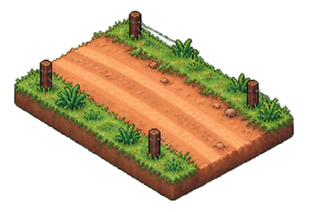

# RIOSE

  

**A browser workspace for exploring livestock scenarios through reproducible simulations.**

Set a starting point, change one management factor, and compare the paths of a demonstrative herd. RIOSE brings scenario inputs, animal states, charts, daily results, and model assumptions together. Its illustrated farm makes those calculated paths inspectable; the outputs remain exploratory, uncalibrated demonstrations, not validated forecasts or management recommendations. A separate archived record documents a narrowly scoped AMD ROCm/PyTorch parity run.

[Product](product.html) · [Scenario Lab](scenario-lab.html) · [AMD evidence](docs/evidence/amd/AMD_VALIDATION.md) · [Scientific model notes](docs/modelos/interface-modelos-cientificos.md) · [Repository guide](docs/architecture/repository-layout.md)

## Product workspace

Describe an experiment, review its assumptions, then confirm the run. Compare scenarios from the same initial population and seed, inspect calculated checkpoints, and export the experiment.

<table>
  <thead><tr><th>Experiment workspace</th><th>Scenario comparison</th></tr></thead>
  <tbody><tr>
    <td></td>
    <td></td>
  </tr></tbody>
</table>

These 4:5 captures document an earlier interface. The current entry is [product.html](product.html); the retired `experiments.html` and `simulator.html` routes redirect there.

## How it works

A deterministic JavaScript engine generates the herd's demonstrative states. Product runs comparisons through a Web Worker, with an in-page fallback when Workers are unavailable. The illustrated scene animates recorded checkpoints and lets you inspect individual engine animals; its scenery and introductory preview are illustrative. Activity histories explain software rules, not observed behavior.

 

Both comparison arms share starting conditions and a seed. Changing one declared factor makes their numerical differences reproducible within the model; it does not establish a causal response in real cattle. Local history and exports preserve inspectable records. See the [execution history guide](docs/historico-execucoes.md) and [versioned scenario contract](docs/scenario-contract-v2.md) for storage, replay, and compatibility details.

 

## Product walkthrough

Open [Product](product.html), use an example or describe a scenario, and review the proposed population, duration, inputs, and assumptions. Confirm to calculate the paths, move between checkpoints, select an animal, or branch from a calculated population state. Technical results include model provenance. Conditional supplement expense requires your price and currency; it is input arithmetic, not predicted profit.

 

Use [Scenario Lab](scenario-lab.html) for multi-scenario comparisons and the conditional BR-CORTE workflow. Explore published measurements separately in the [USDA/CPER](adult-data.html), [adult cow](adult-cow-data.html), and [calf](observed-data.html) pages. Study cohorts have different ages, management, and measurement protocols; their observations do not automatically initialize or calibrate Product. [Outcome review](docs/registro-desfecho.md) documents a separate local projection/outcome record with explicit eligibility and alignment gates.

 

## Visual concept

The cow, road, vehicles, farmhouse, and barn shown here are editorial concept illustrations. Product has its own illustrated farm and engine-state presentation. Neither artwork nor animation establishes biological validity. The [asset sheet](docs/assets/readme/03-visual-concept-asset-sheet.png) collects the broader visual exploration.

  
  &nbsp;&nbsp;
  

## AMD + ROCm evidence

A successful parity run was recorded at release commit [acb5cdf6e3bc23d7e48026bc736da05427f89907](https://github.com/GUZZBR1/riose-agro/commit/acb5cdf6e3bc23d7e48026bc736da05427f89907).

| Workload | Device and runtime | Recorded result |
| --- | --- | --- |
| Livestock metabolism batch | AMD Instinct MI300X VF · ROCm/HIP 7.14.60850 · PyTorch 2.11.0+rocm7.14.1 | `amd_rocm`; 24 animals; 48 outputs; parity PASS; maximum absolute difference 0 at `1e-12` tolerances |

This evidence covers that workload, revision, and environment. It establishes neither performance gains nor biological validity or full-simulator support on current main.

<table>
  <thead><tr><th>01 · AMD environment</th><th>02 · Product validation</th></tr></thead>
  <tbody>
    <tr>
      <td></td>
      <td></td>
    </tr>
    <tr><td colspan="2" align="center"><strong>03 · Backend detection</strong> </td></tr>
  </tbody>
</table>

The [archived validation record](docs/evidence/amd/AMD_VALIDATION.md) contains release-specific reproduction instructions.

## Scientific scope and limitations

- FarmEngine uses simplified equations and fixed assumptions. No dataset calibrates the complete simulator; outputs must not guide real animal-management decisions.
- Observed measurements remain separate from simulations. Public-data comparisons are component diagnostics, not independent validation of the full model. See [scientific evidence](docs/evidence/) for metrics, cohort boundaries, and audits.
- BR-CORTE dry-matter intake applies only within its declared domain. Weight gain and forage stock are supplied inputs, not predictions from that equation.
- Breed labels are metadata; energy and thirst are uncalibrated indices. The interface produces no calibrated prediction intervals. Explanations are not measurements.

Research pages retain source identity and cohort boundaries. CPER yearling grazing records, Nellore feedlot intake, and adult cow datasets address different questions; they are not interchangeable populations. Error metrics and bootstrap intervals in the archived audits describe specific component comparisons, not calibrated uncertainty for a farm forecast. Dataset integrity and agreement with a default equation are separate from full-model validation.

Further scientific development requires a defined cattle scenario, documented equations and calibration, then evaluation against independent measurements. Reproducible execution provides the software foundation for that work; it does not replace the empirical evidence needed to support animal-performance claims.

## Local setup and navigation

Requires Node.js 20 or newer:

~~~bash
npm install
npm start
~~~

Open the printed local URL and select Product. The server binds to loopback. Remote access requires `ALLOW_REMOTE_ACCESS=true`; local snapshot validation is unauthenticated. Optional explanation providers use server-side keys and deterministic fallback; explanations cannot alter calculated results.

The browser code is in `src/client/`; `src/server/` serves the local application. Native Rust execution is a separate [scenario CLI](docs/native-scenario-cli.md); opt-in WASM components are documented alongside the [repository layout](docs/architecture/repository-layout.md). See the [CI guide](docs/ci.md) for checks and toolchains, and the [snapshot guide](docs/snapshot-fazenda.md) for validation commands.

Pages: [home](home.html) · [manifesto](manifesto.html) · [Product](product.html) · [Scenario Lab](scenario-lab.html).

## License, data, and publication

Project code uses the [MIT License](LICENSE). Third-party datasets have distinct terms: inspect each source's `data/**/manifest.json` and [THIRD-PARTY-NOTICES.md](THIRD-PARTY-NOTICES.md) before reuse or redistribution. The [owner-publication readiness review](docs/evidence/actiii-owner-publication-readiness.md) records an unresolved XGain dataset-rights gate. That gate must be resolved before publishing the repository; the code license does not grant dataset redistribution rights.

## RIOSE

  

