# RIOSE

<p align="center">
  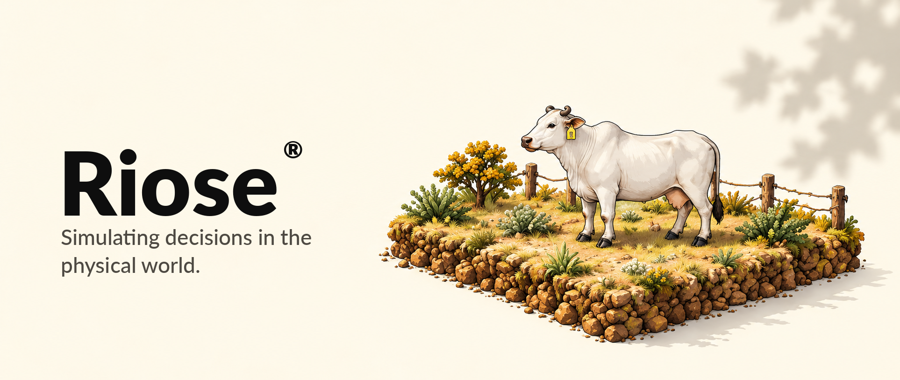
</p>

RIOSE is an experimental, browser-based workspace for exploring livestock scenarios through reproducible simulations. Compare a baseline with a run that changes one selected factor, inspect inputs, charts and daily outputs, and review the assumptions behind each result. The project also records a narrowly scoped AMD ROCm/PyTorch compute validation. Its current FarmEngine outputs are illustrative and are not validated predictions or management recommendations.

The institutional home introduces the project, `product.html` is the primary workspace, and `scenario-lab.html` opens multi-scenario and BR-CORTE tools. The retired `experiments.html` and `simulator.html` addresses redirect to Product.

<p align="center"><code>amd</code> · <code>rocm</code> · <code>pytorch</code> · <code>simulation</code> · <code>livestock</code></p>

[AMD validation record](docs/evidence/amd/AMD_VALIDATION.md) · [Scientific model notes](docs/modelos/interface-modelos-cientificos.md) · [Repository layout](docs/architecture/repository-layout.md)

## License and publication status

Project code is licensed under the [MIT License](LICENSE). Third-party datasets carry separate terms; see each dataset's `data/**/manifest.json` for its source and license. [THIRD-PARTY-NOTICES.md](THIRD-PARTY-NOTICES.md) explains that the XGain files with conflicting license statements were removed from this integration tree; the publication gate remains open pending review of other refs and reachable history. Read the [ACT III owner-publication readiness review](docs/evidence/actiii-owner-publication-readiness.md) before making the repository public; it records the remaining dataset-rights and publication checks.

See the [repository layout guide](docs/architecture/repository-layout.md) for directory responsibilities and the reason browser page URLs remain at the root.

Completed and failed comparisons can be listed and replayed from the browser's local history. See [the local execution history guide](docs/historico-execucoes.md) for its storage, retention, and compatibility behavior.

## Workspace captures

The following images document the experiment interface before its current entry point was consolidated at `product.html`; they are historical UI captures, not a claim that `experiments.html` remains the primary page.

<table>
  <thead><tr><th>Experiment workspace</th><th>Scenario comparison</th></tr></thead>
  <tbody><tr>
    <td>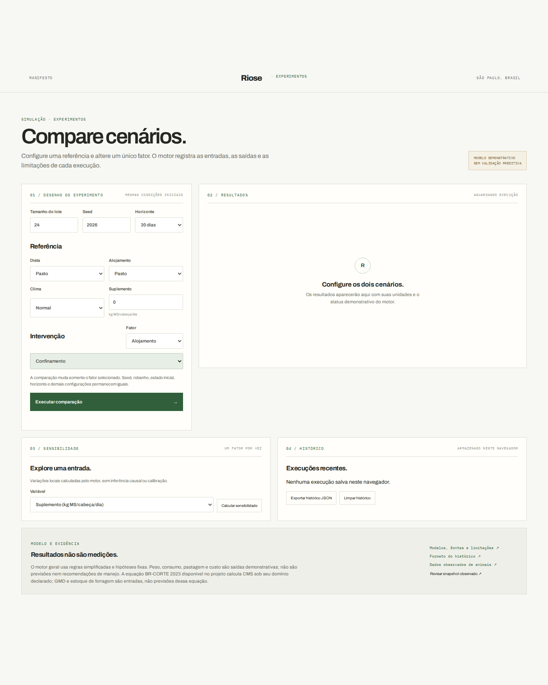</td>
    <td>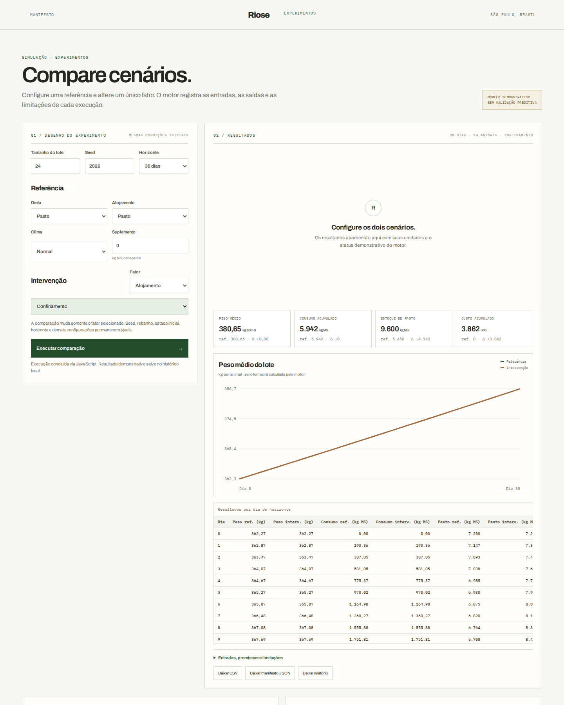</td>
  </tr></tbody>
</table>

## Run locally

Requires Node.js 20 or newer. From this directory:

```bash
npm start
```

Open the printed local URL and choose Product. Snapshot review validates a linked file locally and never applies an uploaded file to a simulation. The bundled server binds to loopback; exposing it on another host requires `ALLOW_REMOTE_ACCESS=true` because snapshot validation is unauthenticated.

The Product simulation workspace does not render a farm or use decorative animals as engine state. The Manifesto has a separate illustrative pixel-art farm; those sprites are not observations or simulation outputs. Scientific charts and research-page illustrations remain separate from both.

The product runs comparisons in a Web Worker; when the local native runner is available it can use Rust and otherwise falls back to JavaScript. `scenario-lab.html` provides multi-scenario comparisons and the conditional BR-CORTE module. `npm run build:wasm` rebuilds the served module and requires the Rust `wasm32-unknown-unknown` target.

### Standalone compute service

An optional Python service can run a bounded livestock-metabolism batch on CPU, CUDA, or AMD ROCm. It is separate from Product's population comparisons, branches, and replay; selecting an accelerator here does not change Product simulation results. Start it in another terminal with `python3 src/server/compute_service.py`, then run `npm run verify:compute-livestock` to compare one deterministic batch against the JavaScript kernel. The verifier reports actual backend use and fallback; CPU-only verification does not establish GPU execution or a performance gain. See [the compute-service contract](docs/compute-service.md).

`npm run bench:wasm-scenario-browser` compares full scenario compute and Worker costs in Chromium; `npm run bench:wasm-scenario-browser:firefox` selects Firefox. These computational benchmarks do not measure UI rendering.

### Optional scenario explanations

The farm engine stays local and deterministic. `/api/explain` receives validated scenario settings and aggregate metrics; its fallback requires no provider or API key. To enable an optional language-provider adapter, set `LLM_PROVIDER=openai|groq|huggingface` and its matching server-side key (`OPENAI_API_KEY`, `GROQ_API_KEY`, or `HF_TOKEN`) before `npm start`; select a model with `LLM_MODEL` or the provider-specific `OPENAI_MODEL`, `GROQ_MODEL`, or `HF_MODEL`. Keys stay on the server. With no provider/key, or if a provider fails, the deterministic explanation is used. Explanations cannot modify simulation results or apply actions and are labeled as not measured.

Open **ADG e pastejo observados (USDA/CPER)** to explore animal-period ADG and grazing measures for the published yearling steers, or **Dados observados** to explore the separate published calf trial. Both pages show measurements separately from simulated results. Repeated animal IDs remain visible as repeated study periods, not independent animals. The USDA/CPER cohort is not labeled as mature cows; its fit to the approved “adult” product scope still needs independent zootechnical review.

An additional public USDA-ARS CPER dataset provides 1,283 individual yearling cattle seasons with entry/exit weights (2000–2019). Reproduce the file and unit audit with `npm run audit:usda-cper-ltgi`, then the fixed 2014–2018 engine ADG diagnostic with `npm run audit:engine-adg-cper-ltgi`. On the same 343 held-out steers, the engine's MAE is 0.414 kg/day versus 0.164 for a constant pre-2014 historical baseline; a weighing/shrink protocol change limits the baseline comparison. The CPER-trained ADG scale was also applied without refit to the public USDA-CGREC steers: MAE 0.222 over 291 records and 0.191 in 2015 (n=200), with high error in the small 1994 subset (n=14). These are exploratory component diagnostics: they do not align initial pasture biomass or all management inputs, support causal treatment claims, validate the full simulator, or calibrate production uncertainty.

The published Nellore feedlot workbook is archived separately under CC BY 4.0 in `data/mendeley-nellore-feedlot/`; it contains individual DMI, weights, drinking events, and weather from a distinct experiment. It is not mixed into the USDA/CPER grazing case. Run `npm run audit:mendeley-nellore` to verify its SHA-256 and report observed versus missing values, or `npm run audit:engine-dmi-mendeley` to compare the frozen default DMI rule against the 219 exact-date weight/DMI pairs. The report includes animal-cluster bootstrap intervals for the fixed-model error metrics; these are not prediction intervals or engine calibration. That narrow out-of-domain check is diagnostic and does not validate the adult grazing case or the full engine.

For a separate no-fit ADG component diagnostic on mature cows, `npm run audit:engine-adg-zenodo-cows` compares the frozen pasture output against ADG derived from the public Zenodo allometry cohort. It uses observed starting weight and an assumed 70-day interval, since exact individual dates and management inputs are absent. Keep the result separate from USDA/CPER; it is not full-engine validation or calibration.

The public UFMS/Mendeley v1 dataset is a separate cohort of 26 male Nelore around 20 months old, not mature cows. `npm run audit:ufms-nelore-grazing` verifies the CC BY 4.0 source; `npm run audit:engine-adg-ufms` runs a frozen no-fit ADG transfer diagnostic on 390 repeated animal-period rows, deriving ADG from endpoint weights and dates because 154 reported GMD values disagree. MAE is 0.449 kg/day (animal-cluster bootstrap metric-stability interval 0.418–0.482); this is not a prediction interval, independent holdout, or validation of the adult pasture scenario.

A second public CC BY source provides adult Angus cows on hay: [`data/sdsu-individual-dmi/`](data/sdsu-individual-dmi/). Its local audit separates group aggregates and the seven complete-case animal tags selected by the authors. Run `npm run audit:sdsu-individual-dmi` to regenerate the DMI derivation and quality report, and `npm run audit:engine-dmi-sdsu` for a fixed-default DMI component diagnostic. The latter uses 571 same-day positive-weight pairs (seven cows) and is out of the approved grazing domain; it is not full-engine validation, and no parameters are fit.

The normalized CC0 calf data snapshot is included so the calf page works offline. To regenerate it from Zenodo and verify the source-file MD5 checksums, run:

```bash
npm run build:observed-data
```

For a local post-decision record, open `outcome-review.html`. The page reads the selected manifest, eligible linked farm snapshot, and archived output locally, then downloads the projection archive and outcome sidecar; no farm record is posted to the server. Archive a comparison with `npm run archive:comparison -- <manifest.json> <comparison-result.json>`. This includes hashes of the exact manifest bytes and `src/client/engine.js` and refuses to overwrite an existing archive. Link a domain snapshot with `npm run link:snapshot -- --snapshot <farm-snapshot.json> --manifest <manifest.json> --output <farm-snapshot-linked.json>`, then validate using `npm run validate:outcome -- <outcome.json> --archive <comparison-result.json> --manifest <manifest.json> --snapshot <farm-snapshot-linked.json>`. A descriptive difference is available only after snapshot, review, consent, access, execution, unit, horizon, quality, and outcome-alignment gates pass; the record never changes the archived projection or simulation parameters. The snapshot linkage verifies lot identity and herd size but does not prove that its fields were mapped into the current numerical engine. See [`docs/registro-desfecho.md`](docs/registro-desfecho.md).

Install the development dependencies once; the tests and snapshot validator use Ajv to check the JSON Schema:

```bash
npm install
```

Run the deterministic engine and data-contract tests with Node.js:

```bash
npm test
```

The supported CI toolchains and checks are documented in [docs/ci.md](docs/ci.md).

Run the preset scenario harness and write one `*.result.json` file per scenario:

```bash
npm run test:scenarios
```

Add a JSON file under `tests/scenarios/` to add a case; the runner discovers files without code changes. Each case declares an `engine` seed and animal count, optional `configuration`, `run.hours`, and JSON Pointer assertions over `/state` and `/metrics`. Supported operators are `equals`, `greaterThan`, `lessThan`, and `approximatelyEquals` (optional numeric `tolerance`). Results go to `.test-results/scenarios/`. To use another fixture and result directory, run `node scripts/experiments/run-scenarios.js <scenario-directory> <result-directory>`. Each invalid or failed case receives its own diagnostic result while other files still run. The harness checks reproducible engine behavior only; its assertions are not scientific validation.

Validate a versioned farm snapshot against JSON Schema and cross-field provenance rules:

```bash
npm run validate:snapshot -- schemas/examples/usda-cper-2019-paddock-19n-eartag-242.json
```

This example is structurally valid but is an observed study slice, not a farm baseline; simulation eligibility is `not-applicable`, and the missing start weight, individual DMI, and paddock area remain explicit. Add `--require-eligible` to make that state return exit code 2.

To create a snapshot copy linked to a comparison manifest, validate the original snapshot and exported manifesto and calculate the hash automatically:

```bash
npm run link:snapshot -- --snapshot farm-snapshot.json --manifest comparison.json --output farm-snapshot-linked.json
```

The command validates the manifest with the engine's existing rules, records the exact file SHA-256 without copying scenario fields, and refuses to overwrite the output. It rejects observed-study slices. Then validate the linked copy with `npm run validate:snapshot -- farm-snapshot-linked.json --manifest comparison.json`; the exact bytes must remain available. Linking does not make a snapshot eligible for simulation.

## Visual references

The illustrations are concept art from the project's visual exploration. They are not rendered by the current simulation workspace and do not represent observed data.

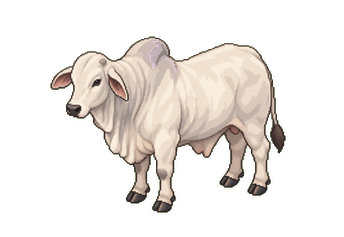

RIOSE focuses on inspectable scenario comparisons, reproducible inputs and clear limits on what the model can support. The cow illustration is a visual reference only.

<br clear="all">

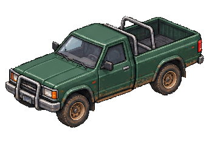

The pickup illustration sits beside the product walkthrough as a farm-context reference; it is not an application feature.

<br clear="all">

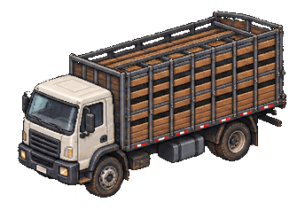

The livestock truck is a separate transparent PNG concept, placed opposite the description to keep it integrated with the README rather than inside a boxed gallery.

<br clear="all">

<p align="center">
  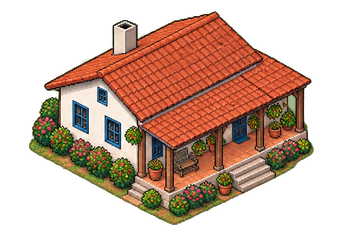
  &nbsp;&nbsp;
  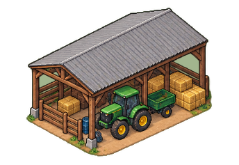
</p>

<p align="center"><sub>Farmhouse and tractor concepts, centered as a pair.</sub></p>

The [isometric asset sheet](docs/assets/readme/03-visual-concept-asset-sheet.png) shows the broader concept set.

## AMD + ROCm validation evidence

A successful parity run was recorded on the separate release commit [acb5cdf6e3bc23d7e48026bc736da05427f89907](https://github.com/GUZZBR1/riose-agro/commit/acb5cdf6e3bc23d7e48026bc736da05427f89907). It covered a 24-animal metabolism batch on an AMD Instinct MI300X VF with ROCm/HIP 7.14.60850 and PyTorch 2.11.0+rocm7.14.1; the recorded backend was `amd_rocm`, with parity passing at `1e-12` tolerances. This is evidence for that workload and environment only, not current-main support, performance gains, full-simulator validation or biological validity.

<table>
  <thead><tr><th>AMD environment</th><th>Product validation</th></tr></thead>
  <tbody>
    <tr>
      <td>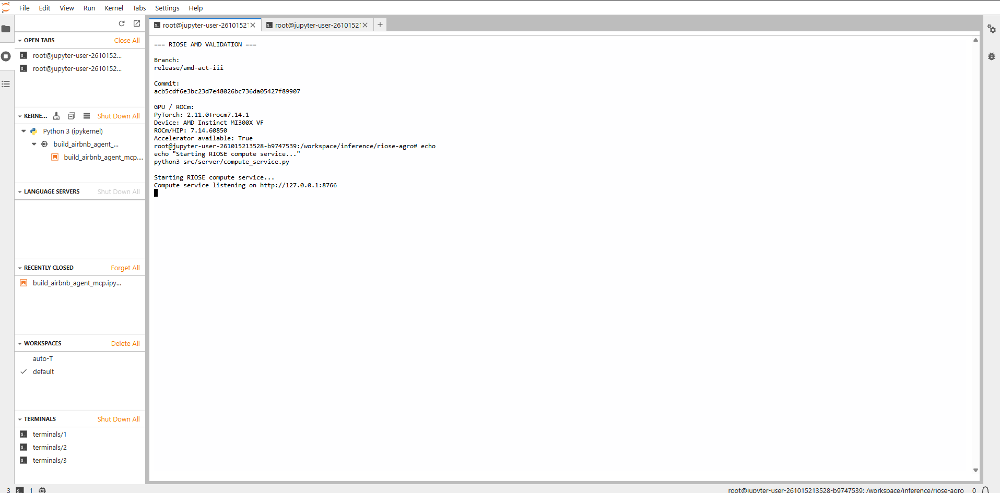</td>
      <td>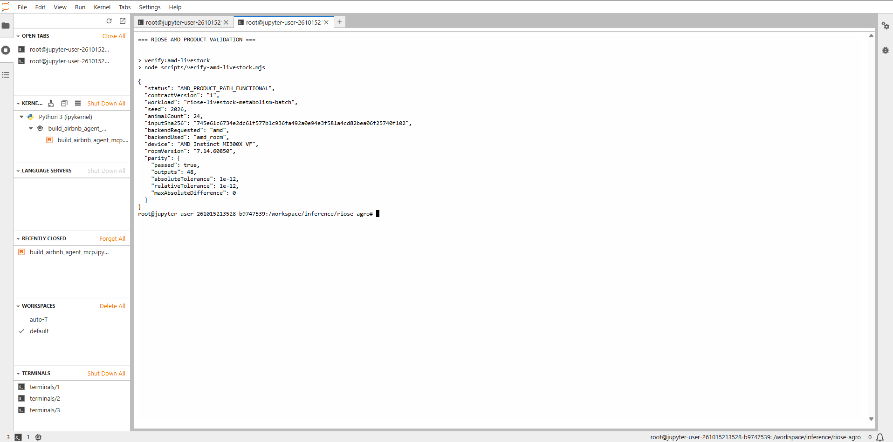</td>
    </tr>
    <tr><td colspan="2" align="center"><strong>Backend detection</strong><br>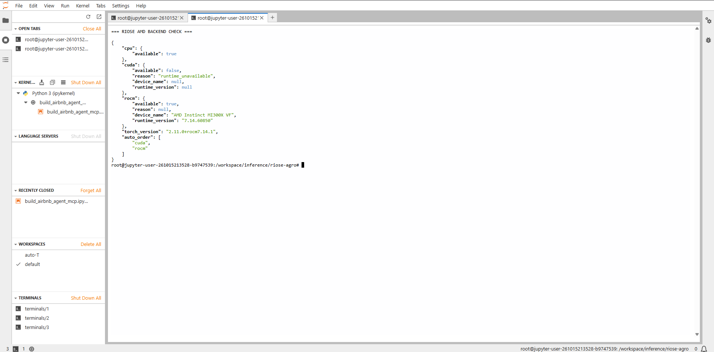</td></tr>
  </tbody>
</table>

The [archived validation record](docs/evidence/amd/AMD_VALIDATION.md) includes reproduction details and explains why the recorded verifier must be run at its original release commit.

## Repository guide

- `home.html` and `manifesto.html` contain institutional project information and identity artwork.
- `src/client/engine.js`, `src/client/feeding-model.js`, and `scientific/` contain the deterministic JavaScript simulation and scientific model contracts.
- `src/client/worker.js` runs simulation work away from the interface; `src/client/worker-protocol.js` validates its messages.
- `crates/riose-core/` contains the native Rust implementation and CLI. `wasm/` contains the opt-in browser kernel.
- `src/server/server.js` serves allowlisted pages and the optional local explanation and snapshot-review APIs.
- `data/`, `schemas/`, `experiments/`, and `docs/evidence/` retain source observations, contracts, reproducible experiments, and archived results.
- `scripts/` contains scientific data audits, builds, reproducibility utilities, and computational benchmarks.
- `tests/` covers simulation determinism, scientific data, scenario replay, Rust/WASM parity, exports, and local server behavior.

The farm renderer, art pipeline, and visual scene editor have been removed. The experiment workspace uses the deterministic engine and keeps observed research data separate from simulated outputs. Historical snapshots remain readable; legacy position and movement fields are accepted where needed for compatibility, but are not emitted or used by the simulation.

## Current limitations

The separate [`rangeland-behavior.html`](rangeland-behavior.html) prototype explores CC BY 4.0 video-annotated behavior records from 24 mature cows. It contains no ADG, weight, or DMI and remains separate from the USDA/CPER analysis and simulation engine.

This is an illustrative software prototype, not a validated livestock or nutrition model. Assumptions are in `src/client/engine.js`; results must not guide real animal-management decisions. No scientific dataset has been used to calibrate the full engine. Public comparisons are scoped diagnostics only: CPER supports observed grazing/ADG exploration, Grass-Cast adds historical group/site-level grazing and forage context, and the Nellore feedlot and Angus hay checks measure one default DMI component in separate, out-of-domain cohorts. None validates the full model. Explanatory text comes from fixed rules or an optional provider and is not a scientific result.

The inspector's activity history records simulated engine transitions and their rule inputs (hour, modeled thirst, and housing). It describes the software's rules, not observed animal behavior.

## Next step

Validate the interaction with users, select a well-defined cattle scenario, replace demonstration equations with documented and calibrated models, then test against independent measurements. Move simulation calculations to Rust/WebAssembly only if profiling shows that the JavaScript engine needs it.

Live demo: https://agro-smallville-mvp.qwdqwdwqdqdqwdwwqqw.chatgpt.site

Os exploradores de dados observados estão em [`adult-data.html`](adult-data.html) (USDA/CPER), [`rothamsted-data.html`](rothamsted-data.html), [`cgrec-data.html`](cgrec-data.html) (USDA CGREC 1989–2015) e [`hpgrs-data.html`](hpgrs-data.html) (USDA/ARS HPGRS 1982–2022). CPER, Rothamsted e HPGRS são coortes de animais jovens/yearlings, não de vacas maduras; cada fonte permanece separada e seus limites etários estão documentados. Use `npm run audit:usda-hpgrs-longterm` para conferir integridade e cobertura, `npm run audit:engine-adg-range` para uma checagem descritiva de faixa de ADG e `npm run audit:engine-dmi-mendeley` para a checagem fixa do DMI em Nelore confinado. Esses checks não validam nem calibram o motor completo.

The versioned scenario contract v2 extends the existing comparison manifest while preserving v1 replay. See [the contract and version policy](docs/scenario-contract-v2.md), [the JSON Schema](schemas/scenario-contract.schema.json), and run `npm run example:scenario-contract` for a deterministic round-trip and replay example.
## Native scenario CLI

The headless Rust runner accepts versioned baseline and housing-comparison
requests. See [the CLI contract and exit codes](docs/native-scenario-cli.md).

## RIOSE

<p align="center">
  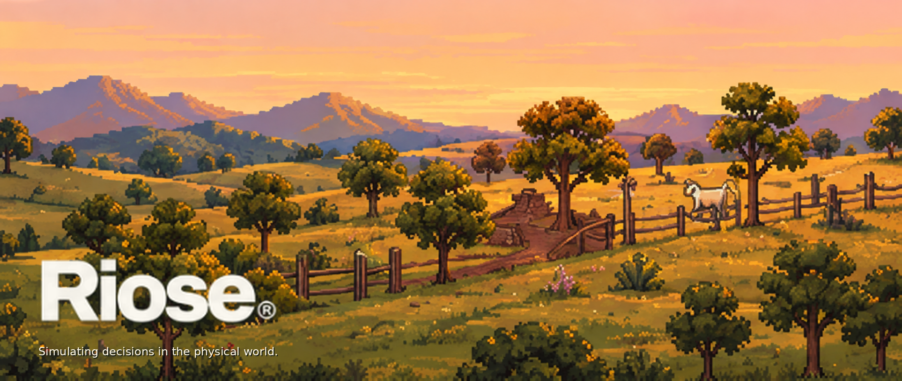
</p>
