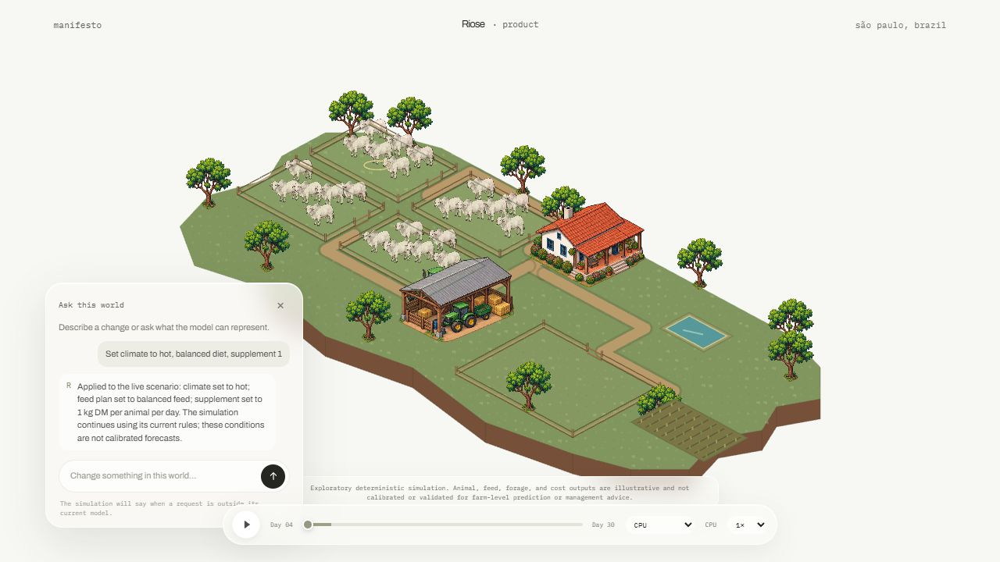
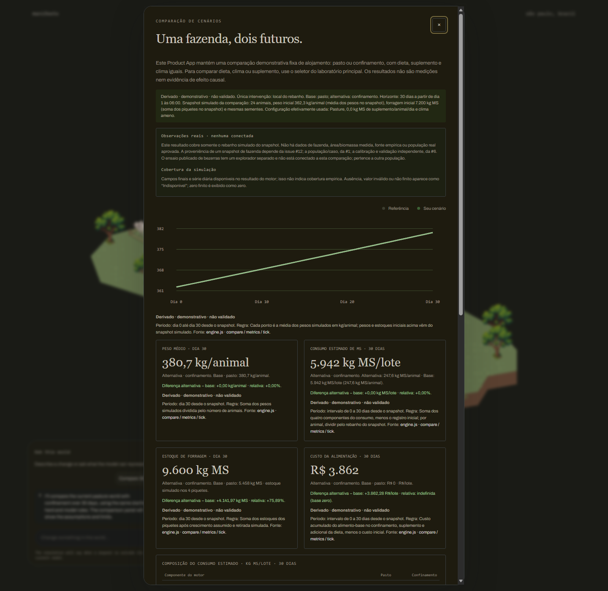

# RIOSE

RIOSE is an exploratory deterministic livestock simulation platform for testing management scenarios and comparing their modeled effects.

## Problem

Livestock scenarios combine choices about animals, feed, housing, and pasture. RIOSE is for people exploring those management choices: it makes selected assumptions visible so users can inspect how its current rules produce modeled outcomes.

## What RIOSE does

The product flow is:

```text
Scenario setup
→ deterministic simulation
→ modeled results
→ scenario comparison
→ explanation/report
```

## Current product

The working browser prototype uses a cattle-farm context. Users configure a scenario, run the simulation, inspect modeled results, compare two 30-day cases, and review the assumptions behind the comparison.

The representative comparison uses the same initial farm snapshot and seed for both cases. It changes housing from pasture to confinement while holding diet, supplement, and weather fixed. The report shows modeled weight, feed cost, dry-matter intake, and pasture stock.

| Product scenario | Scenario comparison |
| --- | --- |
|  |  |

These captures and the [architecture diagram](docs/act-iii/architecture/act-iii-architecture.svg) were recorded at source SHA `0581f6574bc05547a02a88bd95ed4292a0c9b9e5`, before AMD Product integration. They do not show the current AMD selector or establish AMD execution; [#144](https://github.com/santleme/riose-agro/issues/144) remains open for final-candidate visuals.

## Architecture

- **Product UI:** `home.html` is the landing page; `product.html` is the farm experience. `src/client/product-app.js` handles product interactions.
- **Scenario and engine:** scenario settings and presets feed the deterministic rules in `src/client/engine.js` and `src/client/feeding-model.js`. `src/client/worker.js` runs simulation work outside the UI thread.
- **Native and WebAssembly:** the local server can route configured comparisons to the Rust native runner; unavailable or failed native execution falls back to JavaScript. The legacy lab has an opt-in Rust/WebAssembly metabolism path. JavaScript remains the default metabolism path and fallback.
- **Comparison and reporting:** the browser shows paired results and assumptions. Versioned manifests support replay; local history and outcome records do not change simulation results.
- **Explanation boundary:** optional `/api/explain` receives validated scenario settings and aggregate metrics. Its deterministic fallback or optional language-provider adapter can explain results but cannot change the simulation or apply actions.
- **AMD:** Product includes an experimental opt-in AMD/ROCm route for the livestock metabolism batch. The AMD path applies results only when the service identifies `amd_rocm`; otherwise the request fails visibly. CPU remains the default. Integration is present, but real-device execution remains unverified; see the [integration evidence](docs/evidence/actiii-amd-integration-137.md) and [evidence index](docs/act-iii/evidence-index.md).

For implementation details, see the [architecture overview](docs/architecture/architecture-v2.md), [repository layout](docs/architecture/repository-layout.md), and [Rust/WASM decision record](docs/architecture/adr/0002-rust-batch-metabolism-kernel.md).

## Scientific scope

The simulator is deterministic, exploratory, and illustrative. The full engine is not calibrated for a target farm or population and is not validated to predict real farm outcomes. BR-CORTE Eq. 2.6 is a published equation for growing Zebu cattle on supplemented tropical pasture; ADG is supplied as an input assumption. Its published validation within its stated domain does not validate the complete simulator. Tests, parity, benchmarks, and scoped diagnostics show software behavior or component analyses, not biological validation, causal effects, or real-world prediction. Outputs are not farm-level management advice.

See the [#146 scientific-claims review](docs/evidence/issue-146-scientific-claims-review.md), [parameter assumptions and sources](docs/parametros-e-fontes.md), the [uncertainty policy](docs/politica-incerteza.md), and the [module evaluation summary](docs/evidence/scientific-module-evaluations-2026-10-13.md). The [BR-CORTE module scope](docs/modelos/br-corte-2023-cms-pasto.md) describes that equation's domain; it does not validate the full simulator.

## AMD / ACT III status

- **Experimental accelerator work:** a reproducible metabolism benchmark and a no-go report for the captured WSL2 environment are present. That host had no usable ROCm device, so the report contains no accelerator timing or speedup. See the [benchmark report](docs/evidence/amd-metabolism-benchmark-no-go-2026-10.md).
- **AMD product integration:** an experimental Product route for the existing livestock metabolism batch and an explicit CPU fallback are implemented. Issue [#137](https://github.com/santleme/riose-agro/issues/137) remains open, so its release acceptance gate is not marked complete. See the [integration evidence](docs/evidence/actiii-amd-integration-137.md).
- **Real AMD/ROCm execution:** the integration report records `pytorch_unavailable`; no physical device execution, parity result, or AMD timing is available. The captured environment is a no-go; a real-device run remains open in [#138](https://github.com/santleme/riose-agro/issues/138). NVIDIA results are not AMD evidence.
- **CPU path:** JavaScript is the product's default metabolism implementation and fallback. The native comparison route also falls back to JavaScript when the Rust runner is unavailable or fails. The optional WASM path is not an AMD path.

## Reproduction

### Prerequisites

- Node.js 20 or newer for the local server and JavaScript checks.
- Python 3.12 and the pinned packages in `requirements-data-audit.txt` for Python audits.
- Rust stable for native commands. The WASM build also needs `wasm32-unknown-unknown`.

### Install and run

From the repository root:

```sh
npm ci
npm start
```

Open [http://localhost:8000](http://localhost:8000) and choose **Product**. The server binds to loopback; browser modules and workers require HTTP.

### Tests

```sh
npm test
npm run test:scenarios
```

The scenario harness checks reproducible software behavior, not scientific validity. The full CI toolchains and commands are listed in [docs/ci.md](docs/ci.md); the candidate release gate remains open in [#143](https://github.com/santleme/riose-agro/issues/143).

### Optional AMD/ROCm path

Product defaults to CPU. To exercise the experimental AMD route, start the compute service and Product server in separate terminals, then choose **AMD · ROCm** in Product:

```sh
python3 src/server/compute_service.py
npm start
```

This path requires a supported ROCm device. If AMD execution is unavailable, Product reports an error and leaves simulation state unchanged. See the [#137 integration instructions and evidence](docs/evidence/actiii-amd-integration-137.md); physical-device verification remains pending in [#138](https://github.com/santleme/riose-agro/issues/138).

### Relevant accelerator evidence

On a supported host, `verify:amd-livestock` compares the Product metabolism batch against its CPU reference and reports the backend/device. It requires the AMD service above and does not constitute evidence until run on real ROCm hardware:

```sh
npm run verify:amd-livestock
```

The separate benchmark probe records whether a real ROCm device ran; without one it must not be reported as AMD execution:

```sh
python3 scripts/benchmark_metabolism_accelerator.py > report.json
node scripts/validate-benchmark-report.mjs < report.json
```

The captured WSL2 run was a no-go with no accelerator timing or speedup.

## Evidence

See the concise [ACT III evidence index](docs/act-iii/evidence-index.md) for artifact links and gate status.

## Current ACT III status

This README was reviewed against `release/amd-act-iii` at `5c5f07095bf1c8bddb652eb02342ff15b5cc0d56`. That is the current source candidate, not a verified deployment or fully release-tested SHA. The exact release-tested SHA remains pending [#143](https://github.com/santleme/riose-agro/issues/143).

| Area | Current status |
| --- | --- |
| Working prototype | Present; final candidate checks remain open in [#143](https://github.com/santleme/riose-agro/issues/143) |
| Public repository security | `PUBLIC_REPO_SECURITY_BLOCKED`: root `LICENSE` is absent and requires an owner decision; XG-AIN terms conflict, and reuse terms for the grazing-ingestive-behavior RDGV and Perea datasets are missing or unclear. Latest-head secret/path/artifact scans are not complete. See refreshed [#139 audit checkpoint](https://github.com/santleme/riose-agro/issues/139#issuecomment-6181654090). |
| Runtime asset rights | Pending: [#140](https://github.com/santleme/riose-agro/issues/140) remains open with no final asset-clearance report. |
| Judge-accessible repository | Pending [#141](https://github.com/santleme/riose-agro/issues/141); the repository remains private and judge access is unverified. [Repository](https://github.com/santleme/riose-agro) |
| Public demo URL and SHA | No public URL or deployment SHA is published: [#142](https://github.com/santleme/riose-agro/issues/142) remains `#142_BLOCKED_UNKNOWN_DEPLOY_REVISION`. |
| AMD product integration | Experimental route is present and merged through [PR #154](https://github.com/santleme/riose-agro/pull/154); issue [#137](https://github.com/santleme/riose-agro/issues/137) remains open, so release acceptance is not marked complete. |
| Real AMD/ROCm execution | No physical device execution or accelerator timing is recorded; evidence remains pending [#138](https://github.com/santleme/riose-agro/issues/138). |
| Scientific-claims review | Closed in [#146](https://github.com/santleme/riose-agro/issues/146); approved wording is present from merged [#151](https://github.com/santleme/riose-agro/pull/151) |
| Submission screenshots and architecture | [Visual index](docs/act-iii/README.md), screenshots, and diagram are present but captured at `0581f6574bc05547a02a88bd95ed4292a0c9b9e5`, before AMD integration; [#144](https://github.com/santleme/riose-agro/issues/144) remains open. |
| Technical release gate | Pending [#143](https://github.com/santleme/riose-agro/issues/143); no status checks or workflow runs are recorded for source SHA `5c5f07095bf1c8bddb652eb02342ff15b5cc0d56`. |

**Exact release-tested SHA:** not yet recorded; candidate verification remains open in [#143](https://github.com/santleme/riose-agro/issues/143).

The required #145 finalization gates [#138](https://github.com/santleme/riose-agro/issues/138), [#141](https://github.com/santleme/riose-agro/issues/141), [#142](https://github.com/santleme/riose-agro/issues/142), and [#143](https://github.com/santleme/riose-agro/issues/143) are still incomplete. This draft does not claim `ACT_III_README_READY`.

## Limitations

- Outputs are exploratory and illustrative; the simulator is not calibrated for a target farm or population.
- The full simulator is not validated to predict real farm outcomes. Results are not management advice.
- AMD product integration is present but its issue gate remains open; real-device execution evidence is incomplete.
- Root license selection, dataset reuse clearance, and runtime asset rights remain unresolved under [#139](https://github.com/santleme/riose-agro/issues/139) and [#140](https://github.com/santleme/riose-agro/issues/140).
- Current screenshots and architecture predate the AMD Product integration; refresh them against the final candidate under [#144](https://github.com/santleme/riose-agro/issues/144).
- Public demo deployment verification is blocked until its exact repository revision can be identified.
