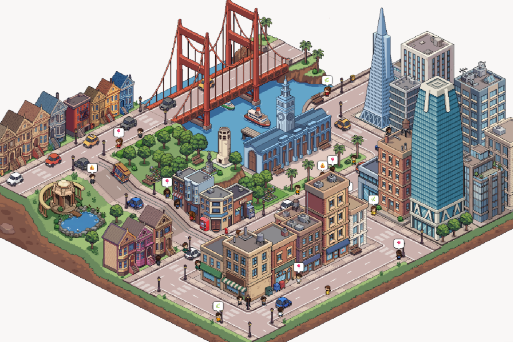
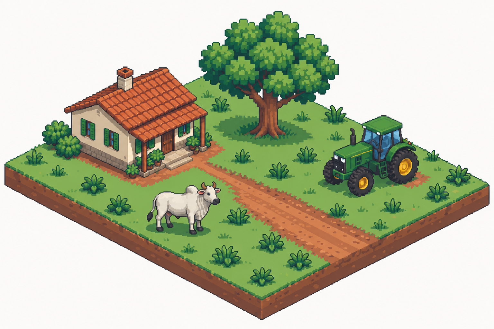

# Amostra de direção artística: pixel art isométrica

**Status: a amostra de seis elementos v3 foi aceita como base estética, com refinamento pendente de contorno e densidade.** A cena mista v7 anterior foi uma prova histórica de composição, não valida a nova cena bovina. As cenas pecuárias v3–v6 estão registradas e reprovadas no [gate atual](assets/review-cattle-pixel/README.md). A curadoria individual segue bloqueada até a prova de cena pecuária atingir o acabamento da referência. A biblioteca permanece fora do runtime e a arquitetura intacta.

## Comparação visual

| Referência urbana dominante | Cena rural candidata — seis elementos |
| --- | --- |
|  |  |

## Elementos da cena

1. Casa rural brasileira com paredes claras, janelas verdes e telhado de telha cerâmica.
2. Uma árvore de sombra em clusters compactos.
3. Um trator verde de fazenda.
4. Um boi Nelore branco-acinzentado com cupim legível.
5. Um trecho curto de estrada de terra.
6. Terreno de pastagem com vegetação baixa intencional.

## Comparação com a referência

- **Projeção e composição:** ambas usam uma planta flutuante em diorama, vista isométrica e arestas de terreno em degraus.
- **Construção dos pixels:** contornos escuros com degraus visíveis, agrupamentos de pixels maiores e formas de volume mais geométricas do que nos atlas semirrealistas anteriores.
- **Sombra e material:** luz superior esquerda, poucos planos gráficos por material e detalhes em pixel nas telhas, rodas, janelas, cupim e bordas da estrada.
- **Paleta e leitura:** verdes, terra, creme e terracota controlados; cada elemento permanece distinguível em escala de mapa.
- **Conteúdo:** os objetos urbanos servem somente como referência de acabamento e composição. A cena usa conteúdo rural brasileiro.

O feedback do usuário confirmou que esta direção está muito mais próxima da referência e deve ser mantida. Ainda há refinamento necessário: contornos mais delicados, copas menos arredondadas e maior densidade de detalhes arquitetônicos e de terreno. A cena pecuária completa é um gate separado e atualmente não passou; não iniciar exports em lote. A decisão de incluir cada asset no kit continua dependendo de revisão individual, transparência limpa, âncoras e conectores.

## Pipeline visual revisto

1. Fixar uma imagem de referência de estilo e manter a mesma imagem como referência dominante em cada lote.
2. Validar primeiro uma cena com poucos elementos distintos, escala coerente e piso diorama; avaliar contorno, tamanho dos clusters, sombra, paleta e densidade antes de criar atlas.
3. Se aprovada, gerar cada sprite em imagem separada usando o mesmo guia, câmera, luz, escala de pixel, paleta e peso de contorno. Não pedir uma folha cheia de objetos para ser fatiada em assets.
4. Exigir PNG RGBA com fundo transparente para props; verificar bordas contra fundo claro e escuro para remover halo colorido. Tiles de chão têm limites de losango explícitos e variantes de borda que conectam sem costura.
5. Curar à mão antes de atlas: comparar silhuetas lado a lado, rejeitar elementos com volume 3D, ruído de textura, anti-aliasing ou escala/luz divergentes. Não tentar corrigir uma pintura semirrealista por redução de resolução ou filtro.
6. Só então padronizar a escala lógica/âncora, montar atlas por categoria e gerar manifesto com o mesmo schema existente.

## Prefixo de estilo para as próximas gerações

```text
Use the attached urban pixel-art isometric game image as the dominant style reference only. Create authentic hand-crafted isometric pixel art, not a painting and not a 3D render. Use a consistent 2:1 game projection, crisp stepped pixel edges, deliberate medium-sized pixel clusters, thin dark 1-pixel outlines, a controlled moderately desaturated palette, flat graphic light and 2–4 hard-edged shade tones per material. Match the reference's pixel density, outline weight, lighting direction, color contrast, geometry and miniature diorama finish. Preserve small intentional readable details. No gradients, anti-aliasing, airbrush, photoreal textures, painterly brushwork, excess micro-noise, soft realistic shadows, bloom, or mobile-game 3D gloss. Reinterpret the style with Brazilian rural subject matter only. For a prop, generate a clean RGBA transparent cutout with no colored halo and a consistent ground anchor. For a terrain tile, make the isometric edges connect seamlessly.
```

The older prompts in [arte-e-pipeline.md](arte-e-pipeline.md) describe the superseded semirealistic art direction; do not use them for regeneration. Preserve the existing asset manifest and simulator renderer until the sample art direction has user approval.
