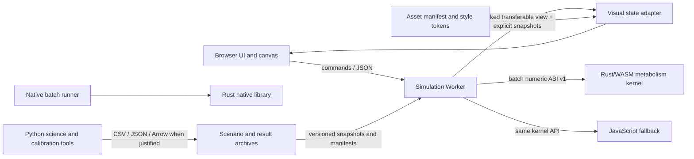

# Riose Architecture V2 (initial cut)

## Goal

Evolve the existing local, browser-based livestock simulator into a modular scientific simulation platform while keeping its current user experience and explicit evidence limits. Use the least costly technology that meets each measured need. Start in-process; a language boundary is not automatically a service boundary.

## Runtime view



## Modules and ownership

- **Simulation Core** owns the clock, deterministic streams, scheduling, command/event interfaces, snapshots and execution metrics. The existing JS engine remains the authoritative compatibility path while the Rust slice is assessed.
- **Domain Modules** own livestock, behavior, feeding, pasture, handling, environment and later technology rules. Their interfaces consume explicit context and return state changes/events; they do not draw pixels.
- **Scientific Models** publish metadata, inputs, parameters, units, temporal resolution, provenance, limitations, uncertainty and validation status. A hypothesis or observed dataset cannot be promoted to a calibrated model by a code path.
- **World System** owns coordinates, paddocks, topology, obstacles and scenario generation. Current world/pasture rules remain in JS in the first iteration.
- **Visual Adapter and Renderer** translate simulation IDs/states to visible state, interpolation, camera, culling and atlas references. The committed baseline uses canvas/DOM; review the parallel V7 asset work before choosing PixiJS.
- **Data Platform** reads/writes JSON configuration, snapshots, manifests, results and experiment metadata. Consider Arrow/Parquet for bulk analytics only after a real export workload.
- **Asset System** owns stable asset IDs, manifest versions, sources, variants, licenses, atlas metadata and style tokens. Preserve the existing V7 direction and the parallel `d99d` pipeline.
- **Hardware Adapters** later translate sensor and gateway protocols into observations with device identity, timestamps, units and quality metadata.

## Initial buildable layout

```text
crates/riose-core/       core runtime primitives and deterministic kernels (native + WASM)
wasm/                    reproducible WASM artifact served to the Worker
src/client/metabolism-wasm.js       JS ABI adapter and fallback implementation
src/client/engine.js / src/client/worker.js    compatibility engine and Worker integration
docs/architecture/       contracts, decisions, audits and roadmap
```

The crate contains a deterministic clock, stable entity-ID allocation, 32-bit model and locomotion seed streams matching the current JS LCG, execution counters, versioned command/event envelopes, generic component snapshots and JSON snapshot encode/decode, plus the metabolism kernel. These primitives are native/WASM-capable; only the metabolism batch is currently exposed to the Worker. Existing JS snapshots and comparison manifest v1 are not replaced. Future crates such as `riose-domain-livestock`, `riose-world`, `riose-simulation` and `riose-bench` should be split when ownership or independent release/build needs exist, not just to mirror folder names.

The browser simulation advances the full model herd independently from rendering. Routine Worker ticks send a compact visual-state buffer; camera, culling and animation stay in the adapter. The initial asset library is capped at 80 reusable semantic sets, including variants and animation within a set; see [visual-asset-budget.md](visual-asset-budget.md).

## Runtime choices

The Worker stays the browser execution boundary. It loads the Rust/WASM batch kernel once, reports the active implementation on state/comparison envelopes, and falls back to the same JS formula if loading fails. Simulation remains callable without rendering. Native Rust runs the same kernel API; Python remains the scientific exploration/calibration environment. No React, PixiJS, C++, GPU, distributed queue or database is introduced by this slice.

See [module-boundaries.md](module-boundaries.md), [data-contracts.md](data-contracts.md), and the ADRs for details. The current slice does not alter the versioned comparison manifest v1.
