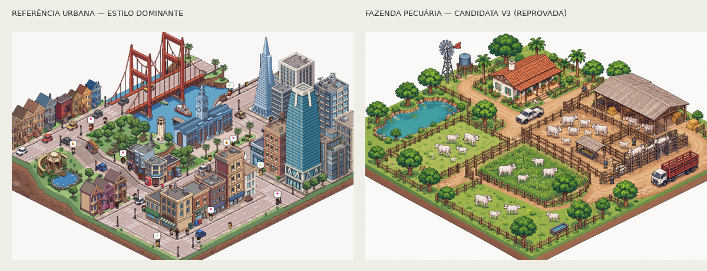
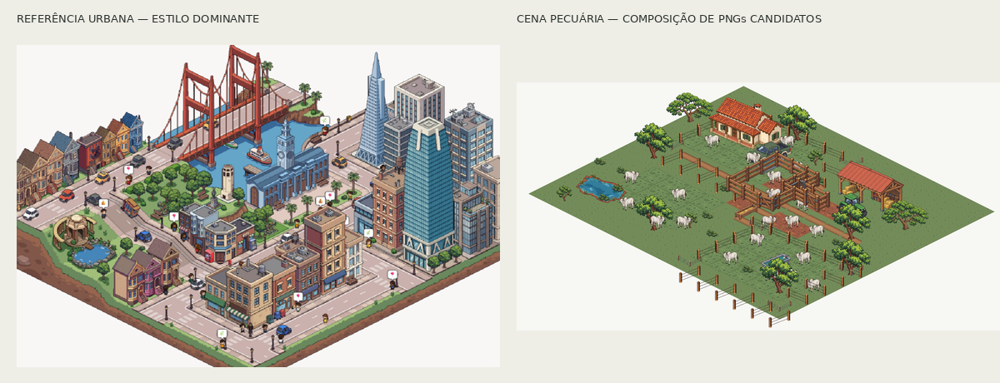

# Revisão de cena pecuária — gate visual

## Candidata v3 — reprovada

Arquivo completo: [fazenda-pecuaria-candidata-v3-reprovada.png](rejected/fazenda-pecuaria-candidata-v3-reprovada.png). A cena contém sede, galpão, curral, Nelore, piquetes, água, cercas, estradas e transporte; ela é uma prova de composição e não um atlas nem sprites aprovados.

**Decisão:** reprovada para produção. A composição está completa e a câmera 2:1 é reconhecível, mas a copa/solo ainda têm volume pictórico e textura orgânica, os contornos são mais pesados que a referência, os bovinos ficam arredondados/semelhantes a ilustração de render e a luz cria gradientes de volume. A imagem não atingiu o critério de pertencer ao mesmo universo de pixel art urbana. Não recortar nem integrar sprites desta cena.

**Correção antes de novo lote:** a próxima prova precisa ser produzida como pixel art nativa com uma grade lógica explícita, planos de cor chapados e clusters maiores e deliberados. Revisar primeiro uma pequena amostra de casa, árvore, bovino e tile de pasto com a referência anexada; ajustar line weight e superfície até o comparativo passar. Só então remontar a cena inteira e iniciar o restante dos 46 IDs planejados.

## Candidatas v4 e v5 — reprovadas após refinamento

Comparativos: [v4](comparativo-referencia-urbana-fazenda-v4-review.png) e [v5](comparativo-referencia-urbana-fazenda-v5-reprovada.png). Cenas integrais rejeitadas: [v4](rejected/fazenda-pecuaria-candidata-v4-reprovada.png) e [v5](rejected/fazenda-pecuaria-candidata-v5-reprovada.png). A v4 reduziu gradientes e deixou a cena claramente pixelada; a v5 tentou usar grade lógica mais baixa, linha fina e clusters mais simples. Ambas mantiveram contorno mais grosso, menor delicadeza e menos detalhe arquitetônico que a referência; o modelo de imagem também reintroduziu volume/textura pictórica. A v5 está em [rejected](rejected/fazenda-pecuaria-candidata-v5-reprovada.png), sem integração ou recorte.

## Candidata v6 — reprovada

[Comparativo v6](comparativo-referencia-urbana-fazenda-v6-reprovada.png) e [imagem completa](rejected/fazenda-pecuaria-candidata-v6-reprovada.png). Usar também a amostra rural v3 aprovada como guia de conteúdo melhorou a cena conectada; contudo, ao lado da referência dominante, vegetação/solo ainda têm textura e volume ilustrativos, e o traço e a densidade arquitetônica não atingem a delicadeza do alvo. Portanto, a imagem falha o gate de “mesmo universo visual” e não é aprovada para produção.

O gate continua **reprovado**. As iterações confirmam que prompting de uma cena inteira não está controlando o estilo com precisão suficiente. Não iniciar o lote de sprites. O próximo avanço requer autoria/curadoria nativa de pixel art em sprites pequenos (casa, árvore, bovino e tile) e validação de cluster/contorno antes de recompor a fazenda completa. A referência fornecida continua sendo dominante; para reduzir a ambiguidade do refinamento, é necessário um sprite rural aprovado com a espessura de contorno/densidade finais, ou produção manual dos sprites de calibração em uma ferramenta de pixel art.

## Composição modular — revisão de conteúdo, não aprovação de estilo

Arquivos: [mapa asset-first](composicao-modular-kit-legado-v1-map-crop.png) e [compositor estático](../kit-pecuaria-bovina-v1/compose_cattle_scene_candidate.py). A prova reúne PNGs existentes do kit misto, remove as lavouras da composição principal e monta sede, galpão, curral, Nelore, pastos, água, cercas, estrada, árvore e veículos. Não desenha assets de mundo com formas de runtime nem modifica o simulador.

**Resultado do teste:** as famílias e zonas podem ser compostas sem lavoura protagonista. Ainda não aprova os sprites: o mapa fica mais vazio que a referência, o detalhe do terreno é baixo e conectores/cercas precisam de curadoria com sprites em escala nativa. Os arquivos de origem continuam candidatos legados e o gate de estilo permanece reprovado.

## Prova de escala v1/v2 — reprovadas

A cena completa inclui sede, galpão, curral e tronco, pastagens subdivididas, Nelore, trator com carreta, utilitário, estrada conectada, açude, infraestrutura de água, vegetação e talhão secundário. A [v1](rejected/fazenda-pecuaria-escala-v1-reprovada.png) e a correção [v2](rejected/fazenda-pecuaria-escala-v2-reprovada.png) foram comparadas diretamente com a referência urbana em [comparativo v2](comparativo-referencia-urbana-fazenda-escala-v2.png).

**Decisão: reprovadas para o gate de estilo e produção.** A composição agora é densa e funcional, mas continua mais cartunesca: contornos grossos, folhagem arredondada e saturada, grandes áreas de sombreado volumétrico e acabamento menos delicado que a referência. A edição baseada na referência não corrigiu essas diferenças. Esta prova valida apenas a distribuição de conteúdo em escala de mapa; não recortar ou integrar os seus objetos como sprites e não iniciar geração em lote.

**Próximo passo necessário:** calibrar manualmente ou com autoria especializada uma pequena amostra rural nativa em pixel art (casa, árvore, bovino e tile de pasto), confrontar a escala lógica dos pixels e a espessura do contorno com a referência urbana e só então recompor a cena completa. Nova tentativa de cena inteira por geração não substitui esse gate.
