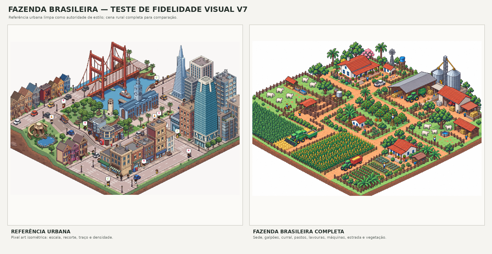

# Histórico de testes de cena: fazenda mista em pixel art isométrica

> Este documento registra uma etapa anterior de fazenda mista. A aprovação direcional da cena mista v7 não se transfere para a pecuária: as cenas bovinas v3–v6 falharam no gate. O foco atual é pecuária bovina; veja a [direção de arte e kit pecuário](pecuaria-bovina-brasileira.md) e a [revisão da cena pecuária](assets/review-cattle-pixel/README.md). Lavouras abaixo permanecem como histórico ou suporte alimentar opcional.

**Status:** v5 reprovada; a cena completa v7 passou na prova de direção para avançar a curadoria. Ela densifica os setores rurais e aproxima os clusters e bordas da referência. A aprovação individual dos 27 sprites continua pendente.

## Comparação lado a lado

A [cena completa v7](assets/review-farm-pixel/fazenda-brasileira-completa-v7-candidata.png) acrescenta currais, piquetes, pastagens, plantações, máquinas e edificações conectadas. O registro das tentativas e a avaliação estão em [review-farm-pixel](assets/review-farm-pixel/README.md).

- Referência dominante (a quinta imagem enviada, pixel-idêntica à captura recuperada de Downloads): [pixel-art-urban-reference-clean.png](assets/pixel-art-urban-reference-clean.png); [original](assets/pixel-art-urban-reference.png).
- Cena v5 reprovada: [fazenda-brasileira-completa-pixel-v5-reprovada.png](assets/fazenda-brasileira-completa-pixel-v5-reprovada.png).
- Cena v4 anterior: [fazenda-brasileira-completa-pixel-v4.png](assets/fazenda-brasileira-completa-pixel-v4.png).
- Cena v3 anterior: [fazenda-brasileira-completa-pixel-v3.png](assets/fazenda-brasileira-completa-pixel-v3.png).
- Cena v2 anterior: [fazenda-brasileira-completa-pixel-v2.png](assets/fazenda-brasileira-completa-pixel-v2.png).
- Cena v1 anterior: [fazenda-brasileira-completa-pixel-v1.png](assets/fazenda-brasileira-completa-pixel-v1.png).

## Conteúdo da cena

- Sede rural, casa de apoio, quintal e galpão de máquinas.
- Curral de manejo com portões, piquetes cercados, bovinos Nelore e bebedouros.
- Pastagem, açude, fardos, árvores de sombra e caminhos de serviço.
- Talhões de soja e milho ligados por estradas de terra que conectam as zonas.
- Silos, estrutura de transporte de grãos, tratores, reboques e equipamentos de pátio.

## Leitura visual

A v5 foi gerada com a referência urbana como alvo de estilo e a v4 somente como guia de conteúdo/layout. Ela testa densidade em uma fazenda brasileira completa: curral, pastos, lavouras, casa, galpão, estradas, açude, árvores e máquinas estão conectados numa única composição.

A v5 demonstra densidade, mas está **reprovada como amostra de estilo** por copas arredondadas, contornos pesados, bordas suavizadas e acabamento de ilustração. A v6 ainda mantinha traço pesado. A v7 corrigiu a leitura de pixel em escala de cena e passou como prova de direção para avançar a curadoria. Cenas completas servem para validar composição, não devem ser fatiadas em sprites; cada PNG precisa passar pelo checklist técnico e visual.

## Composição estática com o kit-base

A [cena de teste v2 montada com PNGs do kit](assets/kit-base-v1/scene-test-v2-kit.png) e o [comparativo urbano](assets/kit-base-v1/comparativo-cena-kit-v2-referencia.png) exercitam a composição asset-first: terreno repetido em grade 2:1, pátios de solo seco, rede de estradas em dois eixos, talhões com tiles PNG nativos, piquete cercado, sprites com alpha e ordenação pela âncora do manifesto. A imagem é uma revisão estática, não é executada pelo simulador. A composição agora tem zonas e conexões mais claras; ainda mantém mais espaço aberto e menos microdetalhe que a referência, e os sprites permanecem candidatos de arte. O [compositor](assets/kit-base-v1/compose_scene_preview.py) e os [geradores de comparativos](assets/kit-base-v1/compose_scene_comparison.py) preservam a revisão reproduzível sem alterar o runtime.

## Verificação de tiles

Os tiles gerados originais continuam reprovados pelas linhas de borda visíveis. Alternativas desenhadas no grid nativo 128×64 passaram apenas pelo teste técnico de repetição: [pastagem (3 variantes)](assets/kit-base-v1/tile-preview-grass-light-03-3x3.png), [solo seco](assets/kit-base-v1/tile-preview-soil-dry-02-3x3.png), [estrada reta](assets/kit-base-v1/tile-preview-dirt-road-straight-02-3x3.png) e [lavoura madura de milho](assets/kit-base-v1/tile-preview-maize-mature-02-3x3.png). As [lavouras nativas](assets/kit-base-v1/tile-preview-soybean-emerging-02-3x3.png) repetem a fase das fileiras sem costura; emergência e densidade visual ainda precisam de refinamento. A [curva de estrada](assets/kit-base-v1/tile-preview-dirt-road-turn-02-3x3.png) não prova conexão funcional com retas e permanece candidata. Repetição sem emenda não equivale a aprovação estética ou de conectores. A [cena montada com o kit](assets/kit-base-v1/scene-test-v2-kit.png) continua como diagnóstico asset-first; a v5 gerada não é usada como tile nem como sprite recortável.

## Escopo preservado

- Nenhum arquivo de arquitetura/renderização do simulador foi alterado para produzir estas cenas.
- O [compositor estático](assets/kit-base-v1/compose_scene_preview.py) usa os PNGs candidatos, tiles e âncoras do manifesto para montar a cena de teste v2; ele não é executado pelo runtime.
- Nenhum atlas legado foi substituído ou conectado ao simulador.
- O manifesto candidato registra a família nova de pastagem com três variantes, tiles nativos tecnicamente repetíveis e uma alternativa de árvore em revisão; atlas legado e runtime permanecem sem substituição.
- A montagem revelou que o kit ainda precisa de maior variedade de terreno, conectores de estrada validados e uma composição mais densa antes de aprovação.
